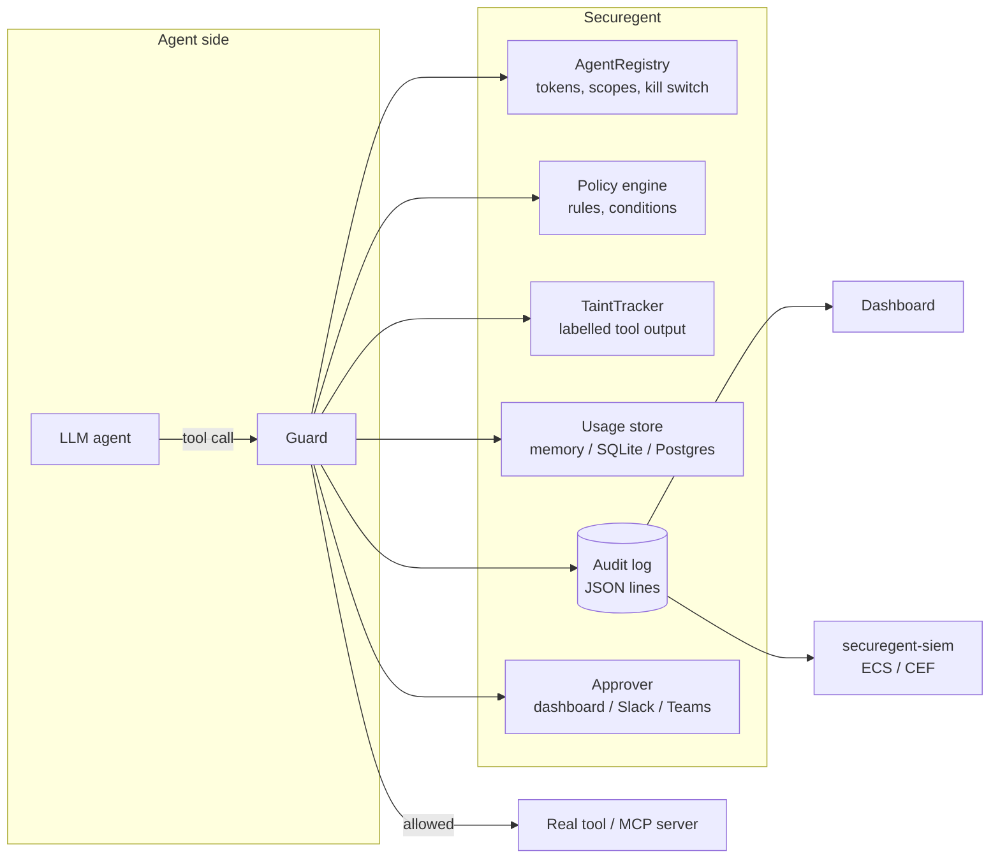
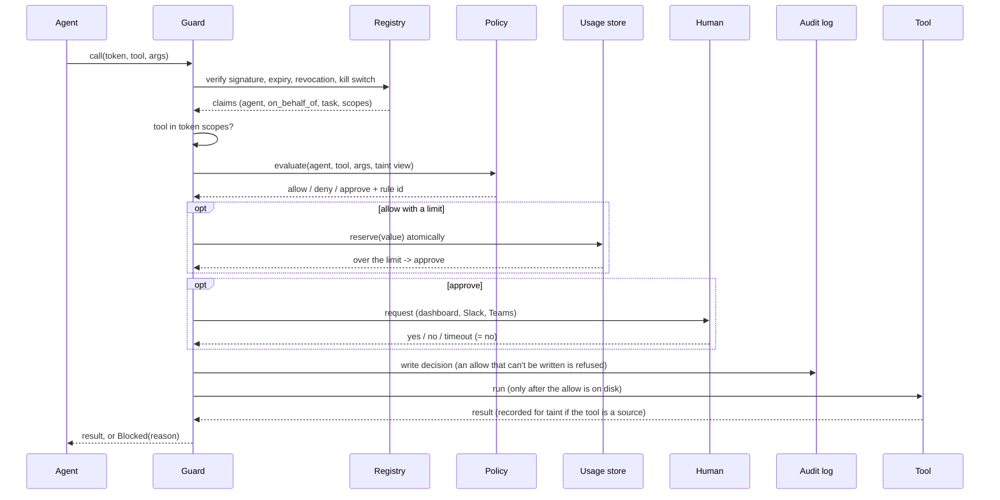

# Securegent design

How Securegent works, why it is built this way, what it defends against, and where it
falls short. The README covers usage; this document covers mechanisms. Every claim here
points to code or a test you can run.

- [Scope](#scope)
- [Why Python, and why no dependencies](#why-python-and-why-no-dependencies)
- [Architecture](#architecture)
- [Request flow](#request-flow)
- [Agent identity and tokens](#agent-identity-and-tokens)
- [Policy evaluation](#policy-evaluation)
- [Running limits and concurrency](#running-limits-and-concurrency)
- [Taint tracking](#taint-tracking)
- [MCP proxy specifics](#mcp-proxy-specifics)
- [Failure behaviour](#failure-behaviour)
- [Threat model](#threat-model)
- [Known bypasses and limitations](#known-bypasses-and-limitations)
- [Measurements](#measurements)
- [Roadmap](#roadmap)

## Scope

The problem: an LLM agent with tools acts on text it reads (emails, web pages, files, tool
descriptions). Some of that text is written by attackers (prompt injection). Model-level
defences reduce the rate of successful injections but cannot guarantee zero, so the
question becomes: **when the model is fooled, what limits the damage?**

Securegent is a reference monitor for tool calls. It sits between the agent and its tools
and decides, per call, from facts it can check: which agent, acting for whom, in which task,
with which arguments, after reading what. It does not look at the model's reasoning and does
not try to detect injections in text; it constrains actions.

Goals: default deny, every decision logged, decisions explainable by a rule id, cheap enough
to put in front of every call, usable without changing the agent's code (MCP proxy).

Non-goals: detecting whether content is malicious, judging whether a business request is
genuine (see [known bypasses](#known-bypasses-and-limitations)), sandboxing the agent's
process.

## Why Python, and why no dependencies

- Most agent frameworks and the MCP and LLM SDKs are Python-first, so a Python library can
  wrap tools in-process with one decorator.
- The core (`securegent/`) uses only the standard library. A security component that sits in
  front of everything should have a small supply-chain surface and be readable in one sitting
  (about 4,000 lines). Optional extras: `anthropic` (demos), `psycopg` (Postgres store).
- Speed is not the constraint: a check costs about 1 ms ([measurements](#measurements)),
  while one LLM step takes seconds.

## Architecture

| Component | File | Responsibility |
|---|---|---|
| Guard | `securegent/guard.py` | Runs the checks in order, records the decision, runs the tool |
| AgentRegistry | `securegent/identity.py` | Agents, signed task tokens, revocation, kill switch |
| Policy | `securegent/policy.py` | Rule matching, conditions, sources for taint |
| TaintTracker | `securegent/taint.py` | Remembers labelled output per session, finds it in arguments |
| Usage stores | `securegent/store.py` | Atomic running totals for limits |
| Approvals | `approvals.py`, `slack.py`, `teams.py` | Human decisions; first answer wins |
| MCP proxy | `securegent/mcp/` | Applies all of the above to any MCP server |

## Request flow

Library use (`guard.call(token, "payments.pay", ...)`):

The order matters: identity before scope before policy, so a forged or revoked token never
reaches policy evaluation, and an out-of-scope tool never reaches the policy author's rules.
Every exit path writes exactly one audit entry with the `stage` that decided (`tool`, `auth`,
`scope`, `policy`, `approval`).

## Agent identity and tokens

`securegent/identity.py`

**Format.** `base64url(JSON claims) + "." + base64url(HMAC-SHA256(secret, first part))`.
Claims: `jti` (random id), `sub` (agent), `owner`, `on_behalf_of`, `task`, `scopes`, `iat`,
`exp`. This is the JWT idea without a JWT library: one fixed algorithm, so there is no `alg`
header to downgrade.

**Issuing.** Requested scopes must each fit the agent's registered `allowed_scopes`
(glob match), so a task token can only narrow what an agent may ever do. Default lifetime is
5 minutes.

**Verifying, in this order:** structure, signature (`hmac.compare_digest`, constant time),
the agent exists, the agent is not disabled (kill switch), the `jti` is not revoked, the token
is not expired. Claims are only trusted after the signature check.

**Key.** `SECUREGENT_SECRET`, or 32 random bytes per process. Random per process means
tokens die with the process, which is the right default when the guard and agent run
together.

**Replay.** Tokens are bearer tokens, so anyone holding one can use it until it expires.
The design assumes the token never reaches the model: in library use the application holds
it, and in the MCP proxy it never leaves the proxy process (the AI app only speaks MCP). So
replay needs code execution on the host, which is outside the threat model. There is no
per-call nonce. Mitigations: short lifetimes, `revoke_token(jti)`, `disable(agent)`. The MCP
proxy issues a long-lived token per session because the session itself is the boundary; the
kill switch is the way to stop it.

## Policy evaluation

`securegent/policy.py`

- Rules are checked **in order; the first matching rule wins; no match means deny.** A rule
  matches when the agent glob, tool glob and all `when` conditions match.
- **Unknown arguments never match.** A condition on an argument the call doesn't have is
  false, so a deny rule doesn't silently match nothing in a way that allows: the call falls
  through to later rules and, eventually, default deny.
- **`matches` is a whole-value regex** (`re.fullmatch`, case-insensitive). `endswith("@acme.com")`
  is a classic bypass (`"x@evil.ru, a@acme.com"`), which the red-team suite found in the
  first version of the sample policy; `fullmatch` closes it.
- **Bad numbers fail safe.** Comparisons on values that don't parse are false; amounts that
  don't parse, are negative or are NaN count as infinite against a limit.
- **`"arg": "*"`** applies a condition to every argument (any must match; for `not_...`, all
  must pass), so "a secret in any argument" doesn't depend on knowing argument names.
- Policies are validated at load: unknown ops, bad regexes, limits on non-allow rules and
  missing labels are errors, not silent no-ops.

## Running limits and concurrency

`securegent/store.py`, `securegent/guard.py`

A limit like "Rs 1 lakh per day" is a check-then-record: two calls arriving together must
not both see room. Every store makes `reserve()` one atomic step:

| Store | How it is atomic | Shared by |
|---|---|---|
| `MemoryUsage` | a `threading.Lock` around read-sum-append | threads in one process |
| `SqliteUsage` | `BEGIN IMMEDIATE` takes the write lock before reading | processes on one machine |
| `PostgresUsage` | a transaction-scoped advisory lock per (agent, rule); the DB clock for timestamps | machines |

Tests start several processes against the same store and check the total granted equals
the limit exactly (`tests/test_store.py`). Table setup in Postgres is also serialised: the
first version crashed when several proxies started at once, because concurrent
`CREATE TABLE IF NOT EXISTS` collides in `pg_type`.

Human-approved calls over the limit still count toward it, so approving one large payment
doesn't reset the budget.

Elsewhere: the MCP proxy checks each `tools/call` in its own thread, so a call waiting for
approval doesn't block pings or other calls; batches are split and every call is checked on
its own; audit writes are serialised by a lock and each entry is one `write()` of one line;
approval files are written to a temp file and `os.replace`d, so readers never see half a file.

## Taint tracking

`securegent/taint.py`

Single-call rules can't see that a URL contains data read two calls earlier. Policies name
**sources** (tools whose output gets a label, e.g. `untrusted`, `confidential`), and rules use
`tainted` / `not_tainted` / `session_tainted` conditions.

Mechanism: source output is normalised (lower case, URL-decoded, `42,000` -> `42000`,
whitespace collapsed) and stored per session (token `jti`), with its bare word sequence. An
argument is split into distinctive pieces: email addresses, URLs, numbers of 5+ digits, long
tokens with letters and digits (API keys, hashes), runs of four words, and the whole value if
short. A piece found in labelled output taints the argument with that label, **unless the
piece is also in trusted text** (the task the human wrote into the token, and their identity),
so an address the user asked for is never treated as attacker-supplied. Evidence (label,
source tool, matching piece) goes to the audit log.

Bounds: 2 MB of source text per session (oldest dropped first), 1,000 sessions (least
recently used dropped).

This is substring matching, not information-flow tracking through the model. It catches
verbatim copying, which is what most injected exfiltration instructions produce, and misses
transformed data (see [known bypasses](#known-bypasses-and-limitations)).

## MCP proxy specifics

`securegent/mcp/`

- **What the server sees is what was checked.** The proxy parses each message and forwards its
  own re-serialisation, so there is no parser-differential gap between the check and the server.
- **Tool names are namespaced** as `<server-name>.<tool>`, so one policy covers many servers
  and one server can't impersonate another's tools.
- **Out-of-scope tools are removed from `tools/list`**, and calls to them are refused anyway.
- **Tool poisoning:** names, descriptions and input schemas are scanned for hidden-instruction
  patterns, secret-file references and invisible Unicode (zero-width, bidi, tag characters);
  each tool's definition is fingerprinted on first sight, and a changed definition later in
  the session (rug pull) drops the tool.
- **Taint through the proxy:** results of allowed calls are recorded before the client sees them.
- **Transports:** stdio or Streamable HTTP to the server; stdio or HTTP (`--listen`) to the
  client. `--listen` binds to loopback, rejects foreign `Origin` headers, gives each client
  session its own upstream connection and token, and refuses non-loopback binds without a
  bearer token.

## Failure behaviour

Securegent fails closed: when it can't do its job, the action does not happen.

| Failure | Behaviour | Where |
|---|---|---|
| Audit log can't be written (disk full, permissions) | Allowed calls are **refused**; denies still deny, with a warning on stderr | `Guard._log`, `tests/test_securegent.py::AuditFailureTests` |
| Tool raises | The allow is already logged; the exception reaches the caller | `Guard.call` |
| Approver doesn't answer | Denied after `--approval-timeout` (default 120 s) | `FileApprover` |
| Slack or Teams unreachable | Falls back to the dashboard; the error says how to fix setup | `slack.py`, `teams.py` |
| Usage store error during a check | The exception propagates, the call doesn't run; the MCP proxy turns it into a refusal | `McpProxy._handle_tool_call_safely` |
| Postgres unreachable at start | The proxy refuses to start | `securegent-mcp` |
| Malformed MCP request | Refused, never forwarded | `McpProxy._handle_tool_call` |
| Upstream MCP server exits | The proxy exits | `StdioUpstream` |
| Unknown tool / unknown argument | Default deny | `Policy.evaluate` |

## Threat model

**Attacker:** controls content the agent reads (email, web pages, files, issue comments, MCP
tool descriptions and results), and may know the policy.

**Trusted:** the host running the agent and Securegent, the policy author, the humans who
approve, the `~/.securegent` state directory.

**Out of scope:** an attacker with code execution on the host; a compromised model provider; a
malicious MCP server binary beyond what its descriptions and results reveal; social
engineering of the human approver.

The state directory is a trust boundary: approvals and the kill switch are files there. An
agent with file access to it could approve its own requests or delete the kill switch, so
**never give agents file access to `~/.securegent`**. `pack:mcp-filesystem` denies any path
inside it (`no-securegent-state`).

## Known bypasses and limitations

Reproducible ones live in [`attacks/known-bypasses/`](../attacks/known-bypasses/), and
`tests/test_community.py` asserts they **still get through**, so this list can't silently
go stale.

| Bypass | Why it works | Possible mitigation |
|---|---|---|
| Fake invoice from the approved vendor, under the daily limit (`bypass-fake-invoice-approved-vendor`) | Every checked fact is within policy; Securegent can't know the invoice is fake | Match payments against an invoice system as a policy source; lower auto-approve limits |
| Base64-encoded leak to an allowlisted site, URL described in words (`bypass-base64-exfil`) | Taint matches copied text, not transformed text, and the URL isn't copied | Decode common encodings before matching; restrict query strings on allowlisted sites |
| Paraphrased or translated data | Same as above | None in substring matching; needs model-level checks |
| Symlink inside an allowed folder | Rules see path strings, not resolved paths | Canonicalise paths in the proxy before evaluation (roadmap) |
| Injection in tool results | Results are recorded for taint but not scanned for instructions | Scan results like descriptions (roadmap) |
| Stolen token replayed | Bearer tokens, no per-call nonce | Keep tokens out of model reach; short TTL; revoke |
| Audit log tampering by a local user | Plain JSON lines, not tamper-evident | Hash-chained log (roadmap); ship to a SIEM in real time |
| Approval fatigue | Humans click approve | Fewer, better approval prompts; limits on approvals per hour |

## Measurements

Every number in the README comes from a command you can run:

| Claim | Reproduce | Saved output |
|---|---|---|
| 14 built-in + 2 community attacks stopped by `policies.json` | `securegent-redteam --policy policies.json --scenarios attacks/` | [`results/redteam-policies.json`](results/redteam-policies.json) |
| Same with `pack:india-finance` | `securegent-redteam --policy pack:india-finance --scenarios attacks/` | [`results/redteam-india-finance.json`](results/redteam-india-finance.json) |
| 0 of 16 stopped without Securegent | `securegent-redteam --no-guard --scenarios attacks/` | [`results/redteam-no-guard.json`](results/redteam-no-guard.json) |
| 14 of 16 stopped: the 2 known bypasses get through | `securegent-redteam --policy policies.json --scenarios attacks/known-bypasses` | [`results/known-bypasses.json`](results/known-bypasses.json) |
| Test suite | `python -m unittest discover tests` | 4 Postgres tests skip unless `SECUREGENT_TEST_POSTGRES` is set |
| Guard overhead | `python scripts/benchmark.py` | below |

Policy-mode red-team runs replay a fully hijacked agent's calls, so they test the policy, not
the model. `--mode agent` runs a real model and is not deterministic.

Guard overhead (Windows 11 laptop, Python 3.12, 3,000 runs each):

| | median | p99 |
|---|---|---|
| Policy evaluation only (india-finance, `email.send`) | 0.12 ms | 0.19 ms |
| `Guard.check` (token, scope, policy, audit write) | 0.91 ms | 1.42 ms |
| Same with 50 KB of taint data in the session | 1.04 ms | 1.51 ms |

The audit write (open, append, close per entry, for durability) dominates.

Live tests, by hand, before releases: the MCP proxy against the official `filesystem` server
(stdio, `--listen` and `--upstream-url`, 22 checks) and the `everything` server over Streamable
HTTP; the Wazuh rules in Wazuh 4.9.2 with `wazuh-logtest` (which found two rule bugs, fixed in
the changelog); Slack approvals in a real workspace; the Postgres store against PostgreSQL 16.4.

## Roadmap

In priority order, with the reason:

1. **Path canonicalisation in the MCP proxy:** closes the symlink gap for filesystem-style servers.
2. **Scan tool results for injected instructions:** results are the most common injection
   channel after documents; reuse the tool-description scanner.
3. **Tamper-evident audit log:** each entry carries the hash of the previous one, so edits are
   detectable; real-time SIEM forwarding already limits the window.
4. **Decode-before-match in taint** (base64, hex, URL-encoding layers) for the encoded-leak bypass.
5. **Signed approval answers**, so a process that can write files in the state directory still
   can't approve.
6. **Per-tool argument schemas in packs**, so a renamed argument can't dodge a condition.
7. **Integrations:** LangChain / LlamaIndex tool wrappers, OpenAI Agents SDK.
